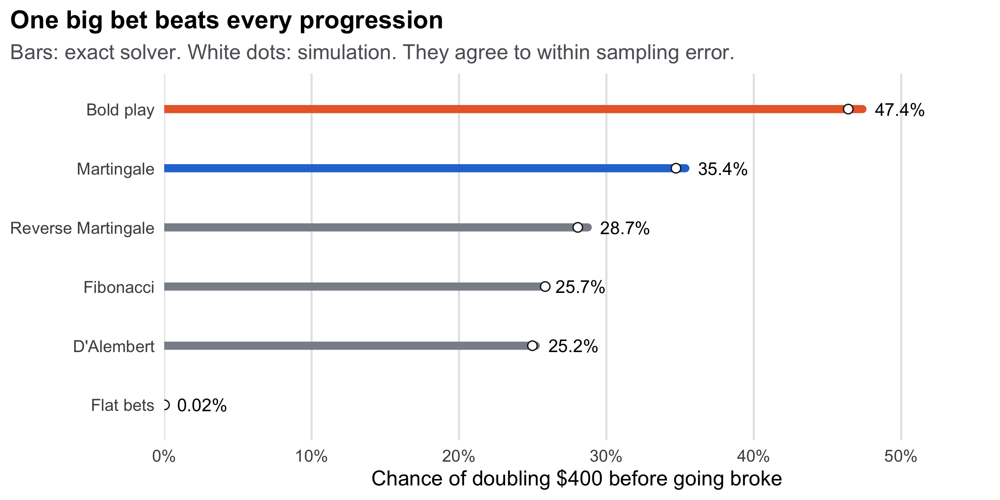

# Can a betting system beat the house?

An analysis of the **Martingale** betting system (double your bet after every loss)
and five other roulette strategies. It uses two independent engines written in R, a
Monte Carlo simulator and an exact Markov-chain solver, which are tested against each
other and against published results.

**[Read the analysis](https://rustyrockets.github.io/martingale-simulator/)** ·
**[Try the explorer](https://rustyrockets.github.io/martingale-simulator/explorer/)**
(runs R in the browser)



## Findings

Scenario: American roulette, betting red, $5 base bet, $400 bankroll, trying to reach $800.

- **Every strategy loses the same share of what it bets.** The average result is
  −5.26% (the house edge) × the total amount bet, exactly, for all six strategies.
  The Martingale makes you bet about 5.6× your bankroll.
- **One bold bet beats the Martingale.** A single $400 bet on red doubles your money
  47.4% of the time, against 35.4% for the Martingale, and loses less on average
  (−$21 vs −$117). Dubins and Savage (1965) proved that bold play is optimal for
  reaching a goal in an unfavourable game.
- **A high win rate is misleading.** Aiming for a $25 profit, the Martingale succeeds
  91% of the time and still averages a loss. The same payoff shape appears in doubling
  strategies outside the casino.

## Usage

```r
for (f in list.files("R", full.names = TRUE)) source(f)

# Exact answer: chance a Martingale player turns $400 into $800
solve_exact(martingale(), bankroll = 400, p = P_AMERICAN, unit = 5, goal = 800)

# The same question by simulation
sims <- simulate_many(10000, martingale(), 400, P_AMERICAN, 5, goal = 800)
mean(sims$reached_goal)

# Compare every strategy at once
compare_exact(all_strategies(), 400, P_AMERICAN, 5, goal = 800)
```

Strategies: `flat()`, `martingale()`, `reverse_martingale()`, `dalembert()`,
`fibonacci()`, `bold_play()`. Each simulator and solver call also takes a
`table_max` (table limit).

Build everything (tests, report, explorer) into `docs/`:

```bash
Rscript build_site.R
```

Requires R ≥ 4.3, [Quarto](https://quarto.org), and the packages ggplot2, dplyr,
patchwork, ggrepel, scales, knitr, rmarkdown, testthat, Matrix, shiny, bslib and
shinylive. Run the tests alone with `Rscript -e 'testthat::test_dir("tests/testthat")'`.

## Structure

| Path | Purpose |
|---|---|
| `R/strategies.R` | Betting strategies as small state machines, shared by both engines |
| `R/simulate.R` | Monte Carlo engine: plays sessions spin by spin |
| `R/exact.R` | Exact engine: solves each session as a Markov chain |
| `R/formulas.R` | Closed-form results from the literature, used to check the engines |
| `tests/testthat/` | Engine vs engine vs published formulas |
| `report/` | Quarto source for the write-up |
| `explorer/app.R` | Shiny app, exported with Shinylive to run in the browser |
| `build_site.R` | Runs the tests and builds the site |
| `.github/workflows/deploy.yml` | Builds and publishes to GitHub Pages on push to `main` |

## License

[MIT](LICENSE)
