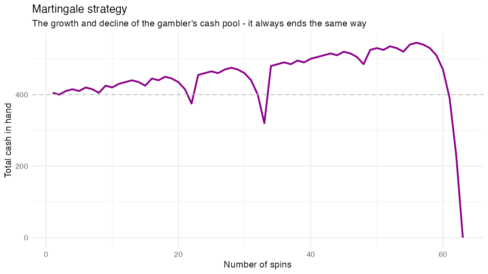
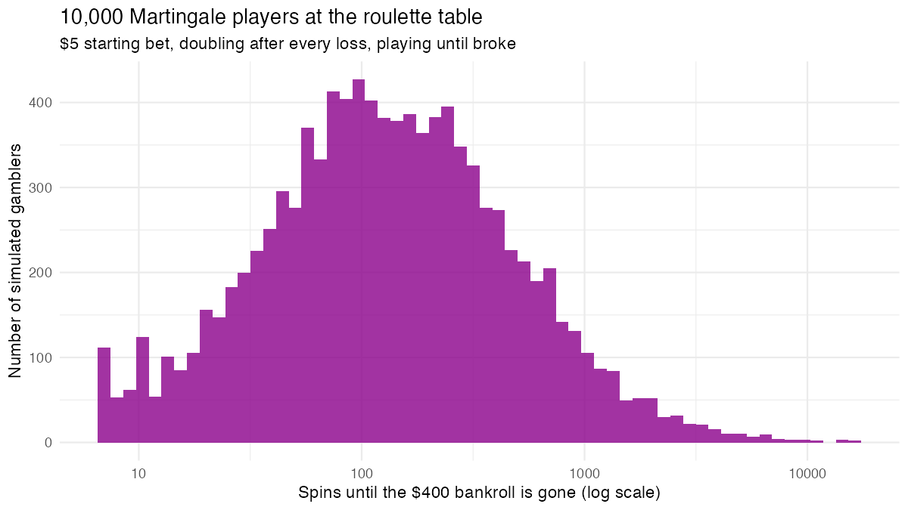

# Can a betting system beat the house?

A small R simulator for the **Martingale** betting system: start with a fixed bet,
double it after every loss, and go back to the base bet after a win. The first win
after a losing streak recovers everything lost plus one base bet, so it *feels*
like a sure thing. This project shows what actually happens to the bankroll.



## What 10,000 players look like

Setup: American roulette betting on red (win probability 18/38), a $5 base bet, a
$400 bankroll, and each player plays until the money is gone.



| | Min | Median | Mean | Max |
|---|---|---|---|---|
| Spins until broke | 7 | 128 | 311 | 16,323 |
| Peak bankroll ($) | 395 | 635 | 994 | 34,915 |

Every player went broke. The typical player was **up more than $200 at their
peak**, which is exactly why the system is so convincing at the table, and then a
losing streak long enough to exceed the bankroll arrived anyway. Doubling bets
changes the *shape* of the outcomes (many small wins, rare catastrophic losses),
but it cannot change a negative expected value.

## Usage

```r
source("martingale.R")

# one run: $5 base bet, $400 bankroll, betting red on American roulette
run <- martingale(bet = 5, cash = 400, p = 18/38)
run$plot

# reverse Martingale (double after wins), walking away at 2x the bankroll
martingale(5, 400, 18/38, reverse = TRUE, stop_factor = 2)
```

`run_simulation.R` reproduces the charts and table above (seeded, about 15 seconds).

| Argument | Meaning |
|---|---|
| `bet`, `cash` | Base bet and starting bankroll |
| `p` | Probability of winning a single bet |
| `reverse` | Double after wins instead of losses |
| `stop_factor` | Walk away once the bankroll reaches this multiple of the start |
| `stop_condn` | Stop once a bet would exceed this share of the cash in hand |
| `stop_on_next_win` | When `stop_condn` triggers, keep going until the next win, then stop |
| `plot` | Build a ggplot of the bankroll over time (returned as `$plot`) |

Requires R and the tidyverse.

## Changes from the original script

The core logic is unchanged from my original script. While publishing it I fixed:
- A first-spin check that errors on R 4.3+ (`||` with a zero-length value).
- `stop_on_next_win` now actually stops at the next win.
- The function no longer fails when `plot = FALSE`.
- The 10,000-run loop no longer draws a plot per run; charts are saved to `images/`.
